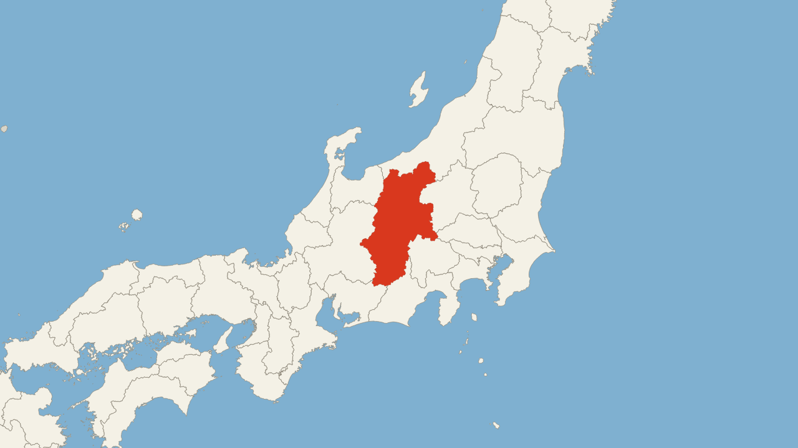
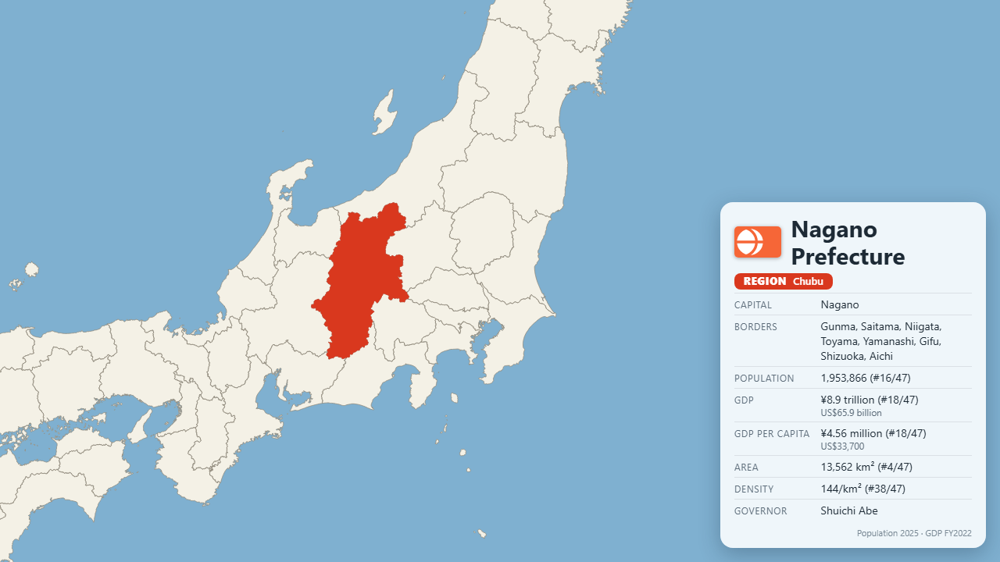
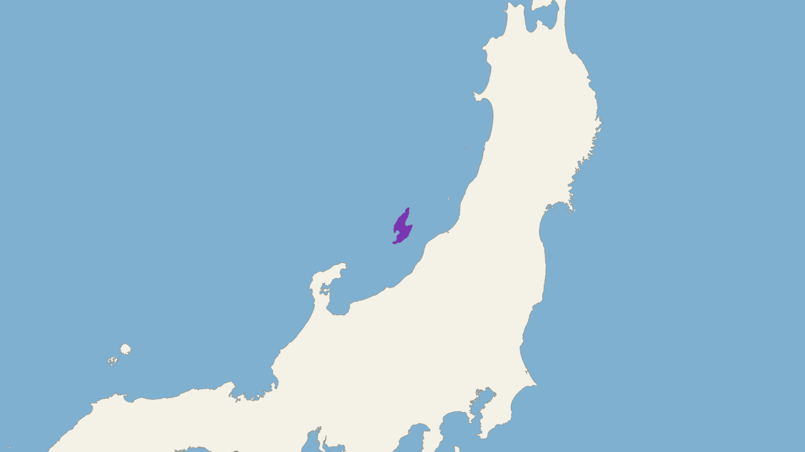
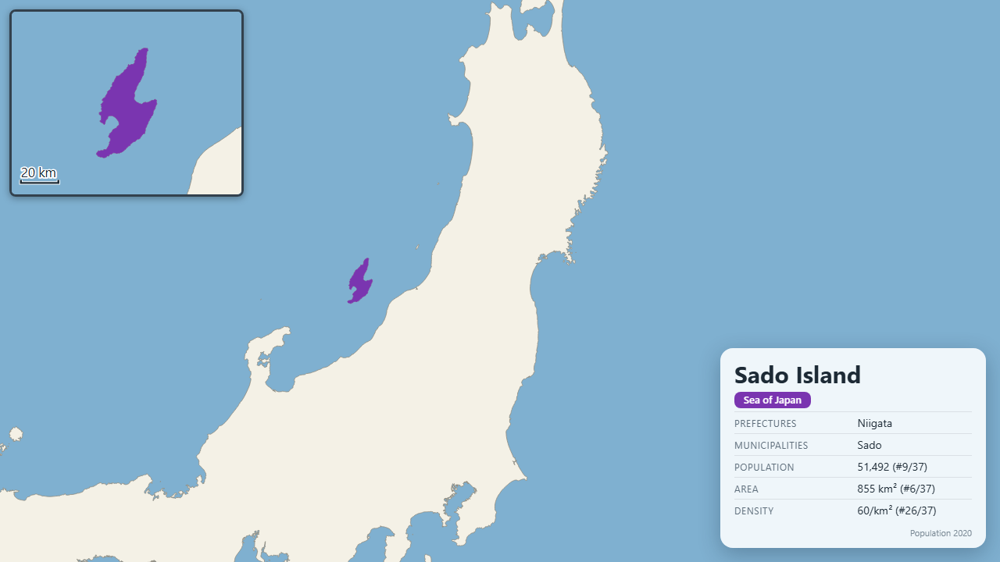
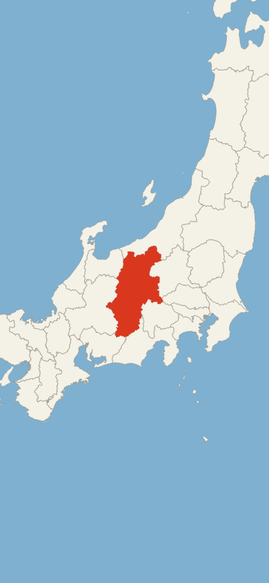
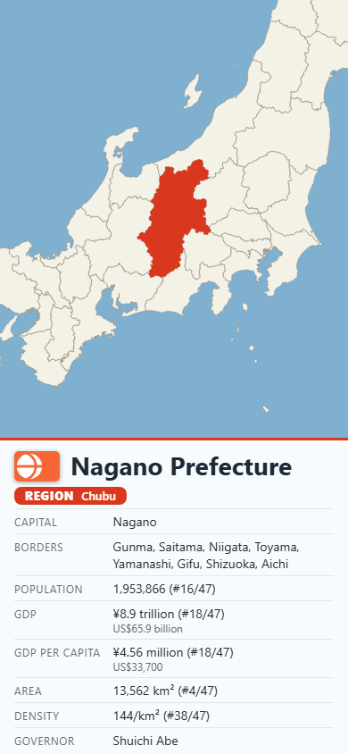
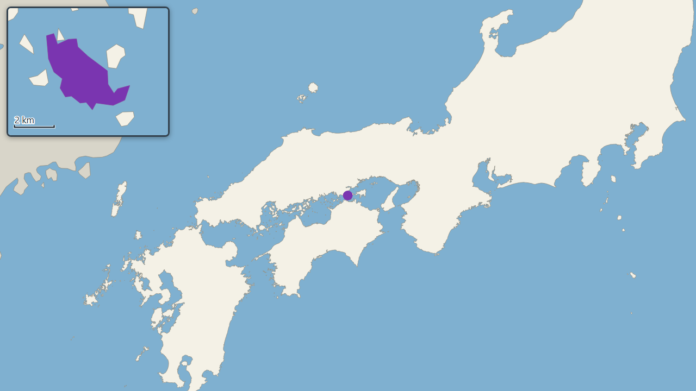
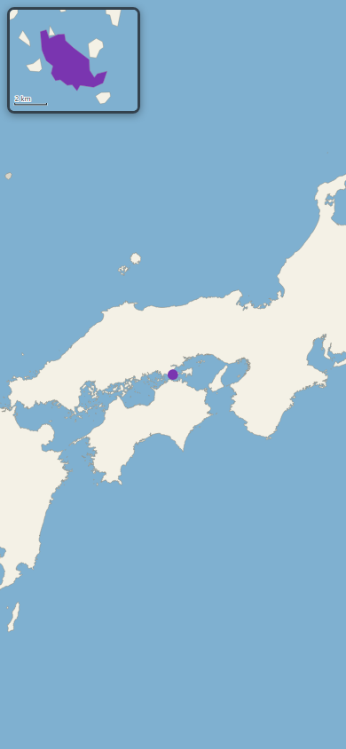

# 🗾 Studying the Japan Map

[](https://github.com/jackindisguise/studying-the-japan-map/releases/latest)
    [](https://ankiweb.net/shared/info/2057876067) [](https://github.com/jackindisguise/studying-the-japan-map) 

**An Anki deck for learning where every Japanese prefecture and major island is, and a few facts about each.**
This project holds everything needed to generate the deck's data, maps and package.

---

## The deck

- **Notes:** one *Japan Map* note per place, with one card, *Locate*: a map with the place highlighted.
- **Islands:** 37, in purple, in their own sub-deck, largest first: the four main islands and 33 others (`data/islands.json`). The disputed Northern Territories islands are not included as island cards; the source map draws them as part of Hokkaido prefecture.
- **Prefectures:** all 47, in red, in one sub-deck per region, ordered north to south (JIS code order).
- **Front:** the map only. The colour says which is being asked: red for a prefecture, purple for an island. Island maps have no prefecture borders.
- **Back:** everything is in English, in the usual spellings without macrons. Under the name, prefectures show their flag, region, capital, largest city (when it is not the capital), bordering prefectures, population, GDP, GDP per capita, area, density and governor. Islands show their island group or sea, prefectures, municipalities, population, area and density.
- **Maps:** one SVG per place, a north-up Mercator view. Far southern islands use wider views.
- **Zoom boxes:** islands under 400 km² also get a zoomed-in box with a scale bar. Prefectures have none.
- **Minimum dot size:** as in the World Map deck, when a place covers very little of the map, each of its parts that would be hard to see gets a solid dot in its colour, larger for the tiniest. This covers small islands and the scattered islands of Okinawa prefecture.

---

## Examples

Screenshots rendered from the card templates with `node scripts/build-examples.js`.

<table>
<tr><td align="center">Front</td><td align="center">Back</td></tr>
<tr><td></td><td></td></tr>
<tr><td></td><td></td></tr>
</table>

<table>
<tr><td align="center">Phone front</td><td align="center">Phone back</td></tr>
<tr><td></td><td></td></tr>
</table>

### Tiny islands

Very small islands (here Naoshima) get a dot on the main map and a zoomed-in box in the top-left corner, with a scale bar.

<table>
<tr><td align="center">Desktop</td><td align="center">Phone</td></tr>
<tr><td></td><td></td></tr>
</table>

---

## Layout

- `scripts/`: data pipeline and map renderer (run everything from the package root).
- `data/`: committed inputs. Hand-kept: `prefectures.json` (romaji, capitals), `cities.json` (other largest cities), `islands.json` (the island list) and `deck-descriptions.json`. Downloaded: `raw/` and `flags-svg/`. Derived: `records.json`.
- `templates/locate/`: the Anki card template and CSS.
- `docs/`: the AnkiWeb page (`ankiweb.md`) and the example images.
- `build/`: generated output (media, `notes.csv`, `.apkg`).

---

## Usage

Requires Node.js 22.12 or newer.

```
npm install
npm run build
npm run apkg
```

`build` writes the records, maps, zoom boxes, flags and `build/notes.csv`. `apkg` writes `build/studying-the-japan-map-<version>.apkg`, ready to import into Anki.

```
node scripts/render-all.js 13 sado
node scripts/build-examples.js
node scripts/build-examples.js 13 sado
npm run fetch:refresh
```

These render single maps (by prefecture code or island id), write the example images, write test screenshots into `build/examples/` (needs Edge or Chrome), and download the sources again.

After refreshing, the build stops if something needs a hand: a new largest city needs an entry in `data/cities.json`, and an island outline that no longer matches its published area is reported. Governors' names are romanised from their kana readings by `scripts/romaji.js`; add exceptions to `OVERRIDES` there. The GDP year is `GDP_YEAR` in `scripts/build-records.js`.

---

## Data sources

- **Prefecture and island shapes:** processed from the National Land Numerical Information (administrative area data, 2021), Ministry of Land, Infrastructure, Transport and Tourism, Japan, simplified to 1% by [smartnews-smri/japan-topography](https://github.com/smartnews-smri/japan-topography). Small islands are correspondingly coarse.
- **Other countries:** Natural Earth (public domain), from the `world-atlas` package.
- **Population and area:** Wikipedia (CC BY-SA). Prefectures use the 1 October 2025 census; islands the 2020 census.
- **GDP:** English Wikipedia's table of Cabinet Office figures, fiscal 2022. GDP per capita divides it by the 2025 population. The US dollar values use the 2022 average exchange rate stated in that table.
- **Capitals, largest cities, regions, governors and island facts:** Wikipedia (CC BY-SA).
- **Flags:** Wikimedia Commons, listed there as public domain except Kagawa's (CC BY-SA 3.0); Commons gave no licence name for Hiroshima's through its API. The files for Oita, Miyazaki, Kagoshima and Okinawa were copied from the Commons mirror in [johnmorrisdotca/hata](https://github.com/johnmorrisdotca/hata).

Borders are land borders; prefectures linked only by bridges or tunnels do not count. Island ranks are among the 37 islands in the deck.

---

## Releases

Releases are set up with [release-please](https://github.com/googleapis/release-please) (`.github/workflows/release.yml`), as in the other map decks: commit to `main` with conventional commit titles, then merge the release pull request. The workflow builds the deck and attaches the `.apkg` to the release.
