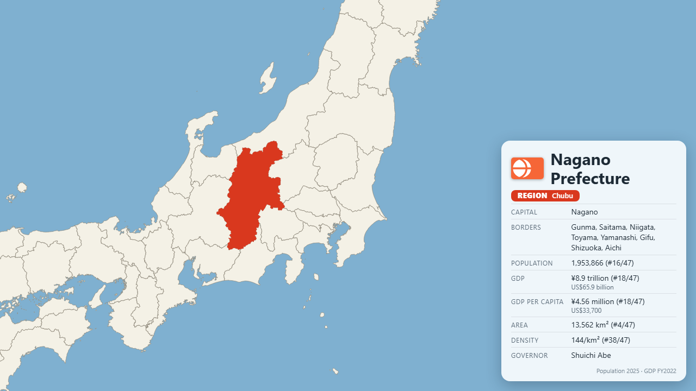
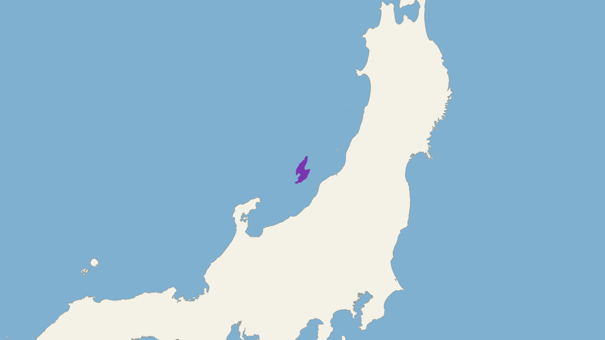
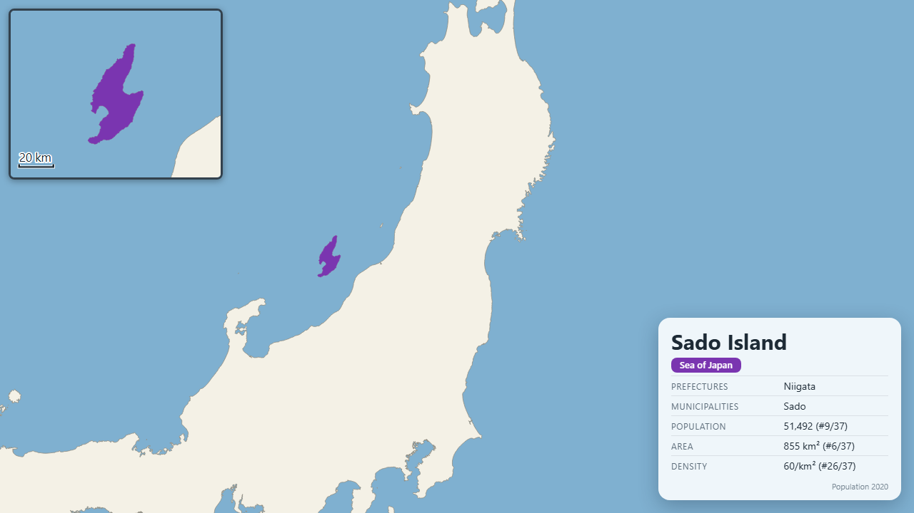
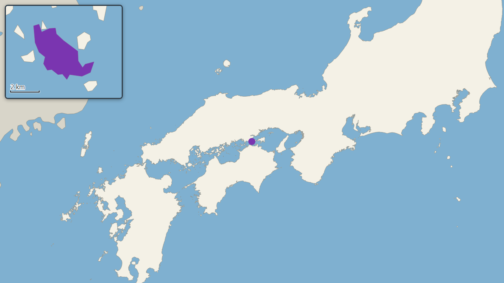
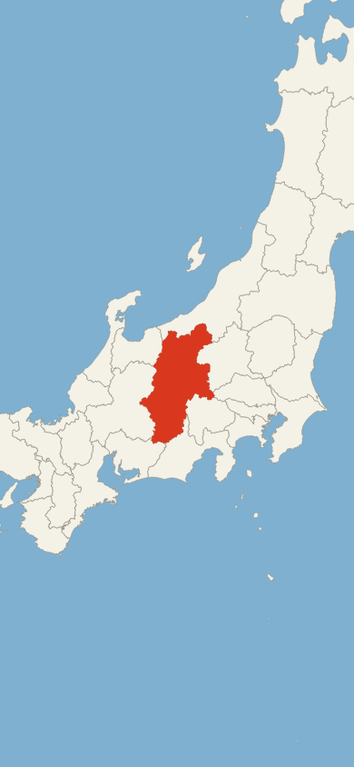
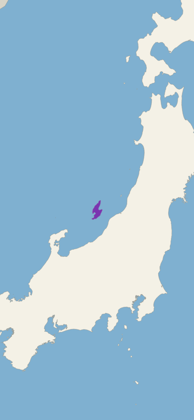
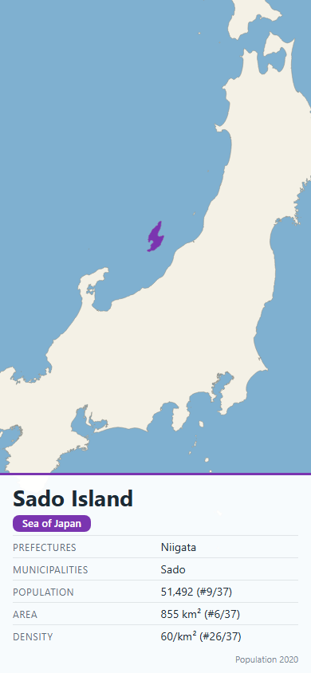

# 🗾 Studying the Japan Map

 <!-- x-release-please-version -->
  

**Learn where every Japanese prefecture and major island is, and a few facts about each one.**
47 prefectures and 37 islands, one card each.

---

## Cards

Find the highlighted place on a north-up map, then flip for the answer: red is a prefecture, purple is an island.

The back shows the name and facts in English. Prefectures include their flag, capital, borders, population, GDP, area, density and governor. Islands include their group or sea, prefectures, municipalities, population, area and density.

### Prefectures

### Islands

### Tiny islands
Small islands get a zoomed-in box with a scale bar, and the hardest to see also get a dot on the main map.

### On a phone
The cards fill the screen on a phone too: the map on top, and the details below it on the back.

---

## Organisation

1. Islands, largest first
2. Prefectures, in eight regional sub-decks, north to south

---

## Accuracy

- US dollar GDP values use the 2022 average exchange rate.
- Prefecture population is from the 2025 census, GDP from fiscal 2022, island population from the 2020 census. Governors are those listed in November 2026.
- Governors' romanised names are generated from their kana readings.
- Borders are land borders only. Island ranks are among the 37 islands in the deck.
- Small islands have simplified outlines.

---

## Sources

- **Map data:** processed from the National Land Numerical Information (administrative area data), Ministry of Land, Infrastructure, Transport and Tourism, Japan (simplified by SmartNews Media Research Institute), and Natural Earth.
- **Facts:** Wikipedia (CC BY-SA).
- **Flags:** Wikimedia Commons; Kagawa's flag file is CC BY-SA 3.0.
