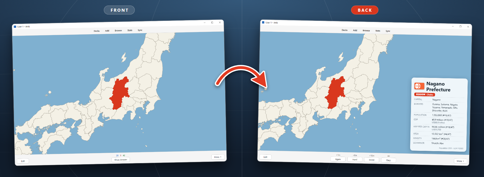
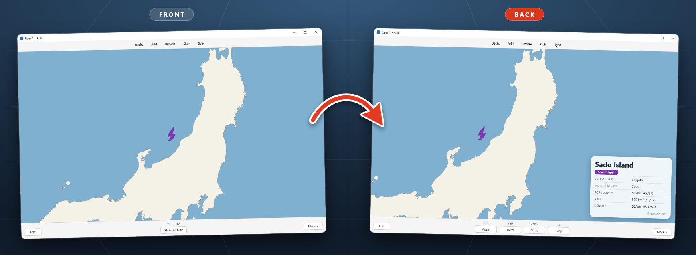
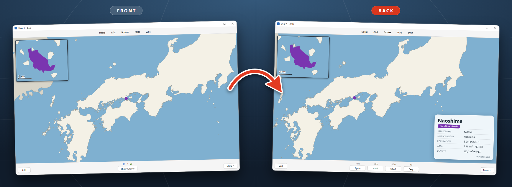
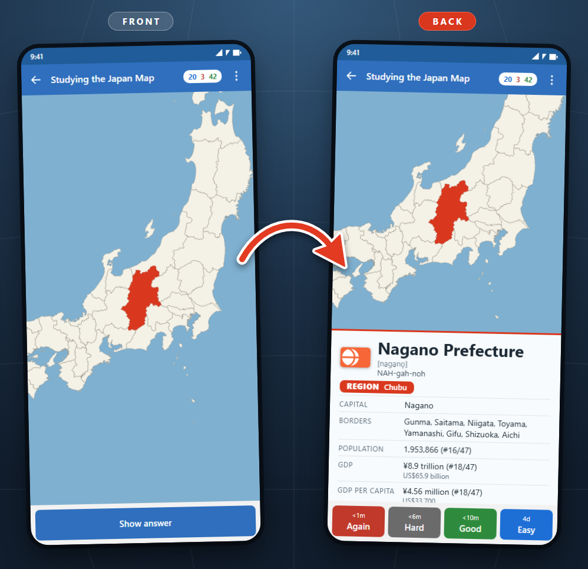
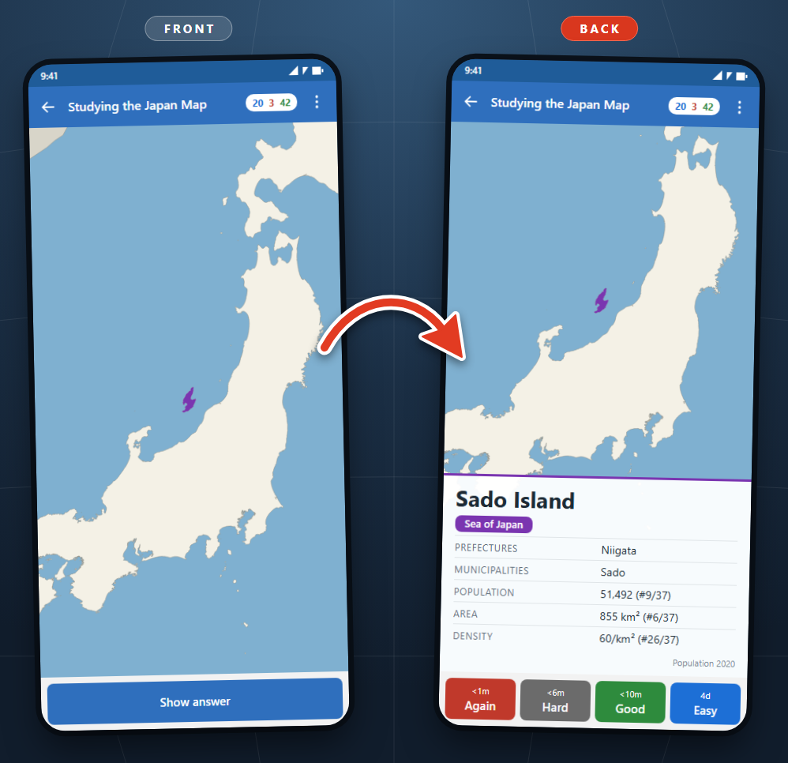
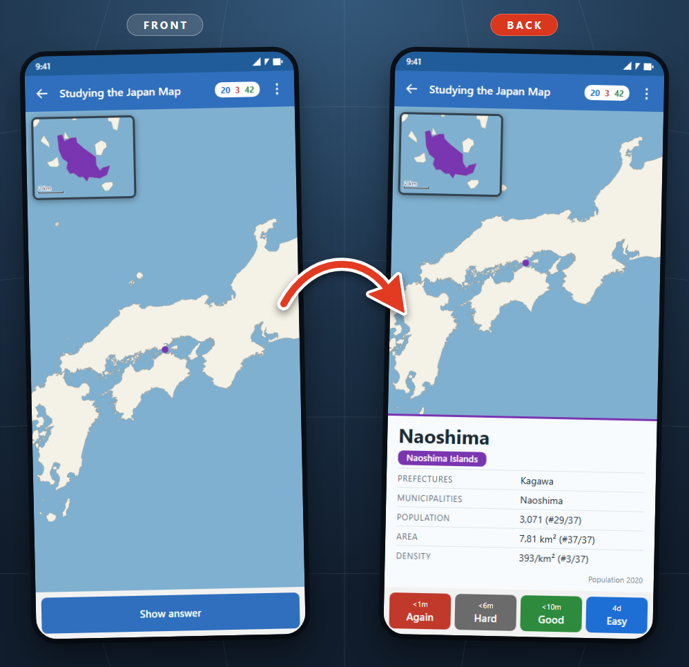

# 🗾 Studying the Japan Map

 <!-- x-release-please-version -->
   
 

**Learn where every Japanese prefecture and major island is, and a few facts about each one.**
47 prefectures and 37 islands, one card each.

---

## Cards

Find the highlighted place on a north-up map, then flip for the answer: red is a prefecture, purple is an island.

The back shows the name and facts in English, with the Japanese pronunciation under most names. Prefectures include their flag, capital, borders, population, GDP, area, density and governor. Islands include their group or sea, prefectures, municipalities, population, area and density.

### Prefectures

### Islands

### Tiny islands
Small islands get a zoomed-in box with a scale bar, and the hardest to see also get a dot on the main map.

### On a phone
The cards fill the screen on a phone too: the map on top, and the details below it on the back.

#### Prefectures

#### Islands

#### Tiny islands

---

## Pronunciation
Each name with a pronunciation shows how it is said in Japanese, in two forms:

> **Nagano Prefecture**
>
> [na̠ɡa̠no̞]
>
> NAH-gah-noh

In the respelling, hyphens separate the syllables. Capitals mark the syllable after which the pitch drops; a name whose pitch never drops, like *hee-roh-shee-mah* (Hiroshima), has none.

- **Vowels:** *ah* father, *ee* see, *oo* goose, *eh* bed, *oh* goat, *ai* price (written *y* after a consonant, as in *hohk-KY-doh*)
- **Consonants:** *ch*, *j*, *sh*, *ts* (cats), *y* (yes); *g* is always hard, and the rest are as written

All 47 prefectures and 12 islands have a pronunciation. The other 25 islands have no recorded pitch accent on Wiktionary, so none is shown.

---

## Organisation

1. Islands, largest first
2. Prefectures, in eight regional sub-decks, north to south

---

## Accuracy

- US dollar GDP values use the 2022 average exchange rate.
- Prefecture population is from the 2025 census, GDP from fiscal 2022, island population from the 2020 census. Governors are those listed in November 2026.
- Pronunciations are standard (Tokyo) Japanese; only one is shown, and the respelling is generated automatically. Iwo Jima's is that of its Japanese name, *Iōtō*.
- Governors' romanised names are generated from their kana readings.
- Borders are land borders only. Island ranks are among the 37 islands in the deck.
- Small islands have simplified outlines.

---

## Sources

- **Map data:** processed from the National Land Numerical Information (administrative area data), Ministry of Land, Infrastructure, Transport and Tourism, Japan (simplified by SmartNews Media Research Institute), and Natural Earth.
- **Facts:** Wikipedia (CC BY-SA).
- **Pronunciation:** Japanese IPA and pitch accents from English Wiktionary (CC BY-SA); the respelling is generated from them.
- **Flags:** Wikimedia Commons; Kagawa's flag file is CC BY-SA 3.0.

---

## Source code
The scripts and data that generate this deck: [jackindisguise/studying-the-japan-map](https://github.com/jackindisguise/studying-the-japan-map).
